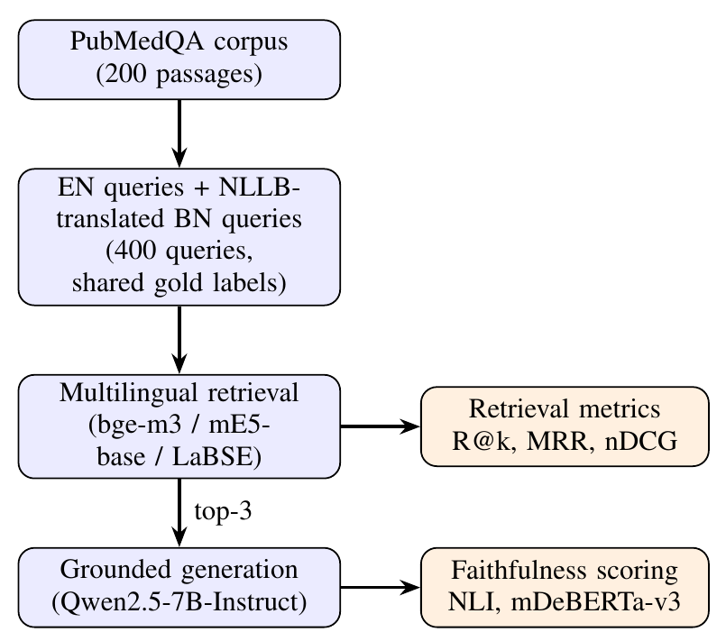

<div id="top"></div>

<br />

<div align="center">

  <h1 align="center">Does Better Retrieval Mean Better Answers? Benchmarking Multilingual Embeddings for Bangla-English Medical RAG</h1>
  <p align="center">
    Joint work between East Delta University and Shahjalal University of Science and Technology
  </p>

  Trina Chakraborty, Jannatul Naima, Rim Chowdhury, and Mst Tuly Khatun.
</div>

<!-- TABLE OF CONTENTS -->

<details open>
  <summary>Table of Contents</summary>
  <ol>
    <li>
      <a href="#about-the-project">About The Project</a>
    </li>
    <li>
      <a href="#getting-started">Getting Started</a>
      <ul>
        <li><a href="#prerequisites">Prerequisites</a></li>
        <li><a href="#installation">Installation</a></li>
      </ul>
    </li>
    <li><a href="#reproduce-results">Reproduce results</a></li>
    <li><a href="#license">License</a></li>
    <li><a href="#contact">Contact</a></li>
    <li><a href="#references">References</a></li>
  </ol>
</details>


<!-- ABOUT THE PROJECT -->

## About The Project

A medical RAG system can fail in two ways: it retrieves the wrong document, or it retrieves the right one and still produces an answer the document does not support. This repository contains a language-stratified benchmark that measures both for English and Bangla. We build a parallel English-Bangla dataset on PubMedQA (200 questions, with the Bangla questions machine-translated by NLLB-200), score three multilingual retrievers (bge-m3, multilingual-e5-base and LaBSE) with Recall@k, MRR and nDCG, and score the faithfulness of the answers generated from their retrieved passages with a multilingual NLI model. Oracle and random-passage baselines, a BM25 baseline, a translate-then-retrieve pipeline and paired bootstrap tests are included.

<p align="center">
  
</p>
:star2: Official implementation to reproduce the main results of our paper **Does Better Retrieval Mean Better Answers? Benchmarking Multilingual Embeddings for Bangla-English Medical RAG**.

**If you use our code, please consider citing:**

    @unpublished{chakraborty2026betterretrieval,
      title={Does Better Retrieval Mean Better Answers? Benchmarking Multilingual Embeddings for Bangla-English Medical RAG},
      author={Chakraborty, Trina and Naima, Jannatul and Chowdhury, Rim and Khatun, Mst Tuly},
      note= {Future Machine Learning and Data Science (FMLDS 2026, Japan)},
      year={2026}
    }

<!-- GETTING STARTED -->

## Getting Started

### Prerequisites

* Python 3.10 or higher
* pip version 21 or higher
* A CUDA GPU (we used an NVIDIA A100 40GB)

### Installation

1. Clone the repo

   ```sh
   git clone https://github.com/jannatulnaima-duck/bangla-medical-rag-benchmark.git && cd bangla-medical-rag-benchmark
   ```

2. Create and activate an environment

   ```sh
   python -m venv .venv
   source .venv/bin/activate
   ```

3. Install required libraries

   ```sh
   pip install -r requirements.txt
   ```

<!-- USAGE EXAMPLES -->

## Reproduce results

The notebook was written for Google Colab, so the easiest way to run it is to upload `notebooks/rag_faithfulness_benchmark.ipynb` to Colab with a GPU runtime. Run the cells from top to bottom. PubMedQA is downloaded from the Hugging Face Hub, so internet access is needed.

* **Data**: 200 PubMedQA questions and their abstracts form the corpus, and the Bangla queries are generated with `facebook/nllb-200-distilled-600M`.
* **Retrieval**: the three retrievers are scored overall and per query language.
* **Generation and faithfulness**: the top-3 passages are passed to `Qwen/Qwen2.5-7B-Instruct`, and each answer is scored with an mDeBERTa NLI cross-encoder.
* **Section 9**: oracle, random, BM25 and translate-then-retrieve baselines, paired bootstrap tests, and a passage truncation report. These cells reuse the variables from the earlier sections, so run the whole notebook in one session.
* The notebook writes its CSV tables and figures to a `results/` folder while it runs. The outputs of our run are kept in the notebook.

<!-- LICENSE -->

## License

Distributed under the MIT License. PubMedQA is distributed under its own [MIT license](https://github.com/pubmedqa/pubmedqa).


<!-- CONTACT -->

## Contact

Jannatul Naima - jannatulnaima.cse.cu@gmail.com & Trina Chakraborty - trinasust5002@gmail.com.
Contact us via email or create github issues if you have any questions/requests. Thanks!


<!-- ACKNOWLEDGMENTS -->

## References

* Qiao Jin, Bhuwan Dhingra, Zhengping Liu, William Cohen, and Xinghua Lu. 2019. PubMedQA: A Dataset for Biomedical Research Question Answering. In Proceedings of EMNLP-IJCNLP 2019.
* Jianlv Chen, Shitao Xiao, Peitian Zhang, et al. 2024. BGE M3-Embedding: Multi-Lingual, Multi-Functionality, Multi-Granularity Text Embeddings Through Self-Knowledge Distillation. arXiv:2402.03216.
* Liang Wang, Nan Yang, Xiaolong Huang, et al. 2024. Multilingual E5 Text Embeddings: A Technical Report. arXiv:2402.05672.
* Fangxiaoyu Feng, Yinfei Yang, Daniel Cer, Naveen Arivazhagan, and Wei Wang. 2022. Language-agnostic BERT Sentence Embedding. In Proceedings of ACL 2022.
* NLLB Team. 2022. No Language Left Behind: Scaling Human-Centered Machine Translation. arXiv:2207.04672.
* An Yang, et al. 2024. Qwen2.5 Technical Report. arXiv:2412.15115.
* Moritz Laurer, Wouter van Atteveldt, Andreu Casas, and Kasper Welbers. 2024. Less Annotating, More Classifying: Addressing the Data Scarcity Issue of Supervised Machine Learning with Deep Transfer Learning and BERT-NLI. Political Analysis.

<p align="right">&#40;<a href="#top">back to top</a>&#41;</p>

<!-- MARKDOWN LINKS & IMAGES -->

[pipeline]: images/pipeline.png
